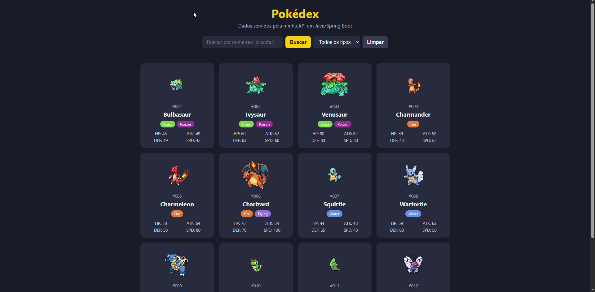

# Pokédex API

API REST em **Java + Spring Boot** que importa dados de Pokémon da [PokeAPI](https://pokeapi.co/), guarda em banco de dados próprio e os serve com paginação e filtros. O projeto também inclui uma interface web simples (HTML, CSS e JavaScript) que consome a própria API.



## Funcionalidades

- Importação automática dos 151 primeiros Pokémon da PokeAPI na primeira execução
- Armazenamento em banco de dados próprio (H2 em memória)
- Listagem paginada e ordenada
- Filtro por tipo (fire, water, grass...)
- Busca por ID e por nome (sem diferenciar maiúsculas e minúsculas)
- Interface web com cards, busca, filtro por tipo e paginação

## Tecnologias

- Java 17
- Spring Boot (Spring Web e Spring Data JPA)
- H2 Database
- Lombok
- RestClient (consumo da PokeAPI)
- Maven
- HTML, CSS e JavaScript puro (front-end)

## Como rodar

**Pré-requisito:** JDK 17 ou superior instalado (com a variável `JAVA_HOME` configurada).

```bash
git clone https://github.com/lucassilvasantos2207-svg/pokeapi.git
cd pokeapi
./mvnw spring-boot:run
```

No Windows, use `mvnw spring-boot:run`.

Na primeira execução, a aplicação busca os 151 Pokémon na PokeAPI, o que leva cerca de um minuto e exige conexão com a internet. Quando aparecer `Started PokeapiApplication`, acesse:

- Interface web: http://localhost:8080
- API: http://localhost:8080/pokemons

> Como o banco H2 roda em memória, os dados são apagados ao parar a aplicação e importados novamente na próxima execução.

## Endpoints

| Método | Rota | Descrição |
|--------|------|-----------|
| GET | `/pokemons` | Lista paginada de Pokémon |
| GET | `/pokemons?tipo=fire` | Lista filtrada por tipo |
| GET | `/pokemons/{id}` | Busca por ID |
| GET | `/pokemons/nome/{nome}` | Busca por nome |

### Parâmetros da listagem

| Parâmetro | Descrição | Exemplo |
|-----------|-----------|---------|
| `page` | Número da página (começa em 0) | `page=0` |
| `size` | Quantidade por página | `size=10` |
| `sort` | Campo de ordenação | `sort=id` |
| `tipo` | Filtra por tipo | `tipo=water` |

Exemplo: `GET /pokemons?tipo=fire&page=0&size=5&sort=id`

### Exemplo de resposta

`GET /pokemons/nome/pikachu`

```json
{
  "id": 25,
  "nome": "pikachu",
  "altura": 4,
  "peso": 60,
  "hp": 35,
  "ataque": 55,
  "defesa": 40,
  "velocidade": 90,
  "sprite": "https://raw.githubusercontent.com/PokeAPI/sprites/master/sprites/pokemon/25.png",
  "tipos": ["electric"]
}
```

## Estrutura do projeto

```
src/main
├── java/com/lucas/pokeapi
│   ├── controller/   # Endpoints REST
│   ├── dto/          # Formato da resposta da PokeAPI
│   ├── model/        # Entidade Pokemon
│   ├── repository/   # Acesso ao banco (Spring Data JPA)
│   └── service/      # Importador de dados da PokeAPI
└── resources/static  # Front-end (index.html, style.css, script.js)
```

## Melhorias futuras

- [ ] Endpoint de comparação entre dois Pokémon
- [ ] Tratamento global de erros com `@ControllerAdvice`
- [ ] Documentação com Swagger (springdoc-openapi)
- [ ] Trocar o H2 por MySQL para persistir os dados
- [ ] Testes automatizados

## Autor

**Lucas Silva Santos**
Estudante de Análise e Desenvolvimento de Sistemas, focado em desenvolvimento backend com Java e Spring Boot.

- Portfólio: https://lucassilvasantos2207-svg.github.io
- GitHub: https://github.com/lucassilvasantos2207-svg
